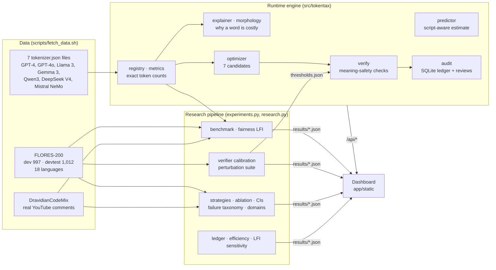
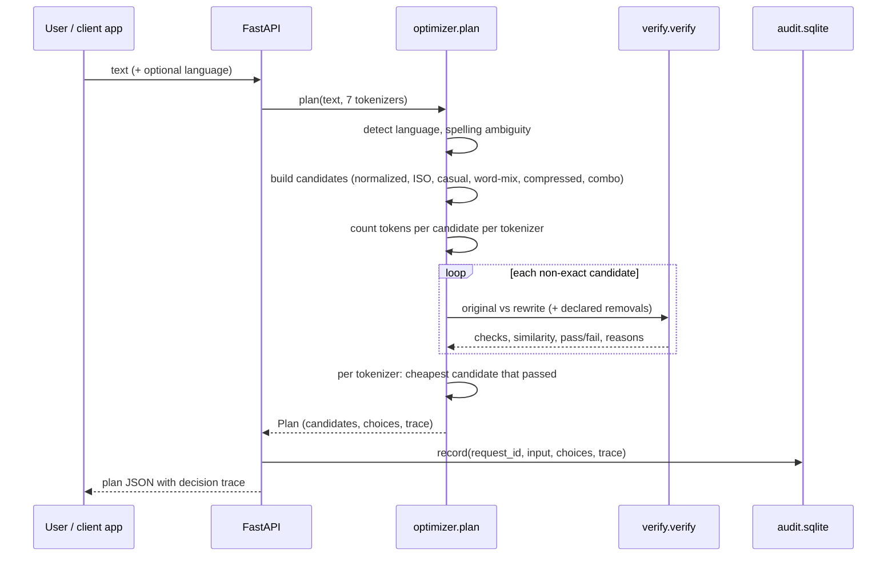
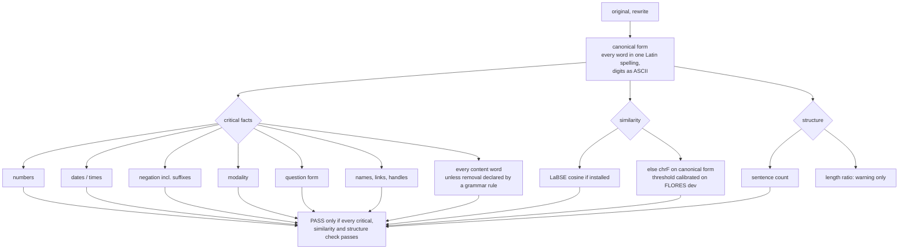

# BhashaToken architecture

BhashaToken has three layers: an offline **research pipeline** that produces every number in
`results/`, a **runtime engine** that optimises one message at a time, and a **FastAPI + vanilla JS
dashboard** that shows both. Everything runs on a CPU laptop; no paid API is needed.

## System overview

## One message, end to end (`POST /api/optimize`)

## Verifier layers (`verify.py`)

A rewrite in casual Latin letters must also keep **spelling ambiguity** at or below 25%: the share of
words whose casual spelling is shared with another word in the FLORES dev vocabulary (for example
"kale" for both ಕಲೆ and ಕಳೆ).

## Modules

| Module | File | Role |
|---|---|---|
| A Measurement | `registry.py`, `metrics.py`, `benchmark.py` | exact counts, fertility, byte-fragment rate, premium vs English |
| B Explanation | `explainer.py`, `morphology.py` | per-word cause: base, vowel-sign split, vocabulary gap; grammar alignment |
| C Normalisation | `normalize.py` | NFC/space/danda candidate; canonical form for checking |
| D Optimisation | `optimizer.py`, `compression.py`, `romanize.py` | 7 candidates, per-tokenizer choice |
| E Meaning safety | `verify.py`, `perturb.py`, `meaning.py` | layered checks, calibration, perturbation suite |
| F Research | `research.py`, `experiments.py`, `fairness.py` | Pareto, CIs, paired tests, ablations, failures, LFI sensitivity |
| G Product | `simulator.py`, `pricing.py`, `router.py`, `audit.py`, `compare.py`, `demos.py`, `app/` | ₹ and context, routing, ledger, reviews, dashboard, proxy |

## API

| Method | Path | Purpose |
|---|---|---|
| GET | `/api/meta` | tokenizers, languages, currency |
| POST | `/api/analyze` | tokens, pieces, byte flags per tokenizer |
| POST | `/api/explain` | per-word causes |
| POST | `/api/optimize` | candidates, choices, decision trace (logged) |
| POST | `/api/verify` | check any rewrite against an original |
| POST | `/api/compare` | same FLORES sentence in 18 languages: characters, tokens, × English, ₹, safe rewrite |
| GET | `/api/compare/search`, `/api/compare/featured` | find parallel sentences by words in any language |
| POST | `/api/demo/conversation` | memory race: per-turn tokens for English, native, optimised |
| POST | `/api/demo/batch` | audit up to 200 messages on one tokenizer |
| GET/POST | `/api/demo/mutations`, `/api/demo/mutate` | one-click safe/unsafe edits checked by the verifier |
| GET/POST | `/rate`, `/api/crowd/*`, `/api/crowd.csv` | live crowd check from phones |
| GET | `/api/health` | `{"ready": true}` once tokenizers are loaded |
| POST | `/api/compress` | grammar-rule compression with edits |
| POST | `/api/predict` | token estimate without the tokenizer |
| POST | `/api/simulate` | daily/monthly/annual ₹, context before/after |
| POST | `/api/route` | cheapest model + format |
| GET | `/api/audit`, `/api/audit/{id}` | ledger |
| POST/GET | `/api/review`, `/api/reviews`, `/api/reviews.csv` | human evaluation |
| GET | `/api/results/{name}` | experiment results (whitelisted names) |
| POST | `/v1/chat/completions` | OpenAI-compatible proxy; dry run unless `TOKENTAX_UPSTREAM` is set |

## Constraints met

* CPU only; peak process memory is reported in `results/efficiency.json`.
* No paid API: tokenizers are local files; LaBSE is optional.
* The audit database is a local file (`var/audit.sqlite`); disable with `BHASHATOKEN_AUDIT=off`.
* Input length is capped at 5,000 characters; result names are whitelisted.
